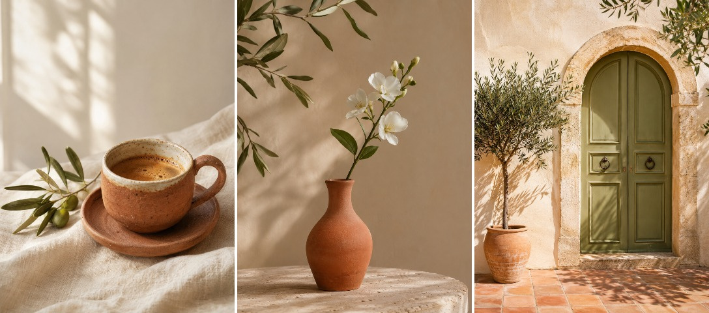
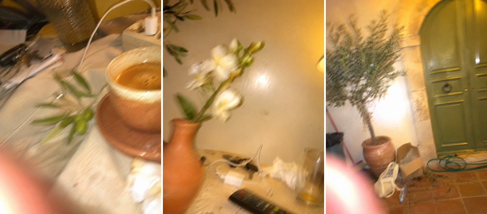
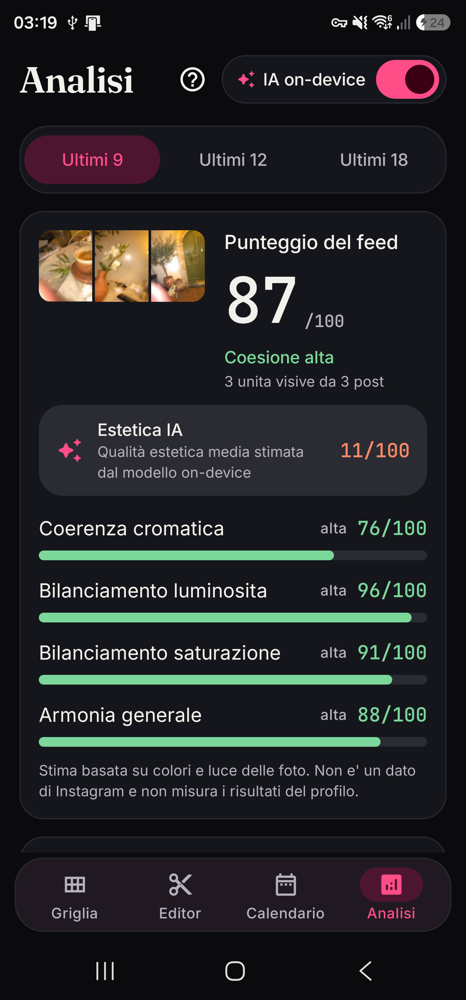

# NiwLayrApp

**English** · [Italiano](README.it.md)

**Personal Android project · Kotlin · Jetpack Compose · in development**

NiwLayrApp helps photographers and creators design a visual feed before publishing it.
It brings content planning, an editor for posts, carousels and mosaics, and analysis
tools together in one app that runs entirely on the device.

## Main feed screen

The grid shows the posts, the palette and the feed score. The example is loaded with
three demonstration posts created with AI.

## The problem

Preparing a feed usually means moving between the gallery, editing tools, notes and a
calendar. NiwLayrApp lets you arrange and review the content in a single place, without
connecting a social account or uploading your images to a server.

## Main features

- **Visual planning:** grid preview, reordering, and placeholders for ideas not shot yet.
- **Creation:** an editor for single posts, carousels and mosaics, with saved projects and image export.
- **Editorial calendar:** content scheduling and local reminders; the app never posts to social networks by itself.
- **Feed analysis:** indicators derived from visual features, plus an additional aesthetic score from an AI model running on the phone through TensorFlow Lite.
- **Data handling:** backup and restore of projects, so the work can be moved between devices.

## Design choices

The app is written in Kotlin with Jetpack Compose and Material 3. Images and analysis
stay on the device: no backend, no Instagram account and no remote analytics service are
involved. The basic analysis stays available even when the AI score is switched off.

The work meant handling image import, editable projects, several content formats, export
and local persistence, while keeping the experience coherent across screens.

## Heuristics against the AI score: a test inside the app

To compare the two signals I generated three curated images with AI, plus three
deliberately degraded versions of the same scenes. Both feeds use similar subjects and
colours; the degraded ones are blurry, badly framed and badly lit. The previews and
screenshots below were generated or captured by the app on a Galaxy S23 Ultra. They
contain no personal photographs.

| Curated feed | Degraded feed |
| --- | --- |
|  |  |
|  |  |
| Feed score **81/100** · AI aesthetics **51/100** | Feed score **87/100** · AI aesthetics **11/100** |

In this test the heuristics, which lean mostly on colour and light, score the degraded
feed higher, because its images stay chromatically consistent. The aesthetic model, on
the other hand, does tell the curated photographs from the blurry, badly composed ones.
The scores describe only these two demonstration feeds: they are neither a measure of the
model's accuracy nor a prediction of how a feed would perform on social media.

## Status

NiwLayrApp is being evaluated ahead of a possible commercial release. It is not on the
Play Store today. This page documents the project; the source code and the model file are
not public. The images shown here are demonstration material created for this page.

## Licence

All rights reserved — see [LICENSE](LICENSE).
