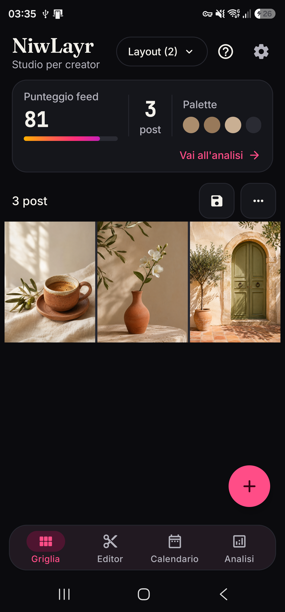
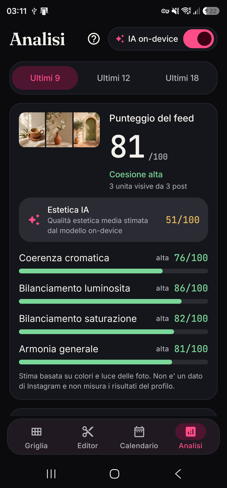

# NiwLayrApp

**Progetto personale Android · Kotlin · Jetpack Compose · in sviluppo**

NiwLayrApp aiuta fotografi e creator a progettare un feed visivo prima della pubblicazione. Riunisce la pianificazione dei contenuti, un editor per post, caroselli e mosaici e strumenti di analisi in un'app che lavora sul dispositivo.

## Schermata principale del feed

La griglia mostra i post, la palette e il punteggio del feed. Nell'esempio sono caricati tre post dimostrativi creati con IA.

## Il problema

Preparare un feed richiede spesso di passare tra galleria, strumenti di modifica, appunti e calendario. NiwLayrApp permette di organizzare e rivedere i contenuti in un unico spazio, senza collegare un account social o caricare le proprie immagini su un server.

## Funzioni principali

- **Pianificazione visiva:** anteprima della griglia, riordino dei contenuti e segnaposto per le idee ancora da realizzare.
- **Creazione:** editor per post singoli, caroselli e mosaici, con salvataggio dei progetti ed esportazione delle immagini.
- **Calendario editoriale:** programmazione dei contenuti e promemoria locali; l'app non pubblica automaticamente sui social.
- **Analisi del feed:** indicatori basati su caratteristiche visive e una valutazione estetica aggiuntiva tramite un modello IA eseguito sul telefono con TensorFlow Lite.
- **Gestione dei dati:** backup e ripristino dei progetti per trasferire il proprio lavoro.

## Scelte di progetto

L'app è sviluppata in Kotlin con Jetpack Compose e Material 3. Le immagini e l'analisi restano sul dispositivo: non sono necessari un backend, un account Instagram o servizi di analisi remoti. Le funzioni di base dell'analisi restano disponibili anche quando la valutazione IA è disattivata.

Il lavoro ha richiesto di gestire importazione delle immagini, progetti modificabili, formati di contenuto diversi, esportazione e persistenza locale, mantenendo coerente l'esperienza tra le schermate.

## Euristiche e valutazione IA: una prova nell'app

Per confrontare i due segnali ho creato con IA tre immagini curate e tre versioni volutamente degradate delle stesse scene. Le immagini dei due feed hanno soggetti e colori simili; quelle degradate sono sfocate, mal inquadrate e illuminate male. Le anteprime e le schermate seguenti sono state generate o acquisite dall'app su un Galaxy S23 Ultra. Non contengono foto personali.

| Feed curato | Feed degradato |
| --- | --- |
|  |  |
|  |  |
| Punteggio del feed **81/100** · Estetica IA **51/100** | Punteggio del feed **87/100** · Estetica IA **11/100** |

In questa prova le euristiche, basate soprattutto su colore e luce, danno un punteggio più alto al feed degradato perché le immagini restano cromaticamente uniformi. Il modello estetico distingue invece le foto curate da quelle sfocate e mal composte. I punteggi descrivono soltanto questi due feed dimostrativi: non sono una misura di accuratezza del modello né una previsione dei risultati sui social.

## Stato

NiwLayrApp è un progetto in fase di verifica prima di una possibile distribuzione commerciale. Non è attualmente disponibile sul Play Store. Questa pagina documenta il progetto; il codice sorgente e il file del modello non sono pubblici. Le immagini mostrate qui sono materiali dimostrativi creati per questa pagina.
